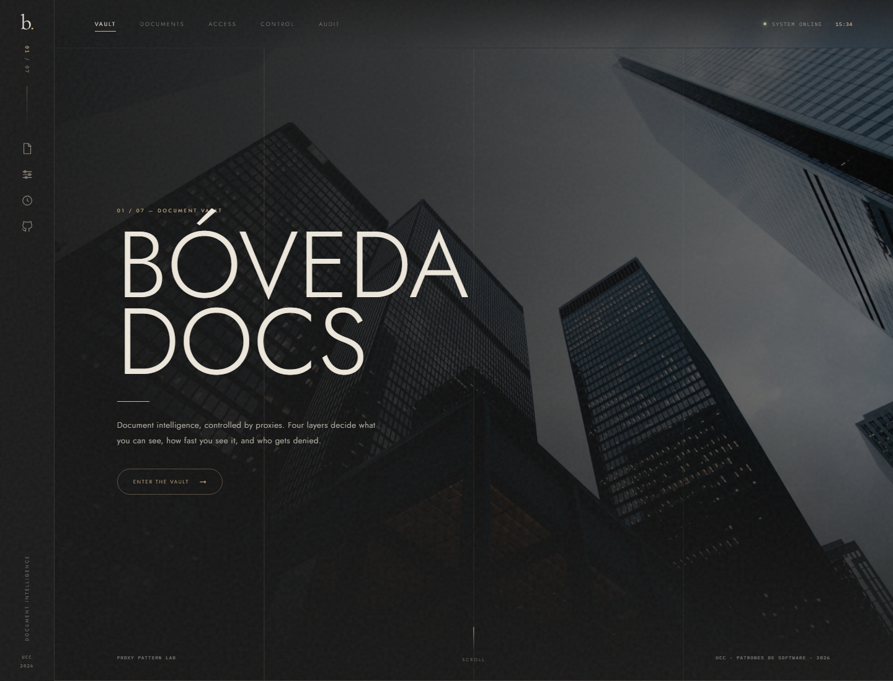

# proxy_frontend- — BóvedaDocs (Patrón Proxy)

Frontend estático en **HTML, CSS y JavaScript puro** (sin frameworks) para el laboratorio del patrón **Proxy**. La dirección visual sigue el lenguaje editorial de **go.arch**: carbón, hueso y oro, tipografía con tracking amplio, líneas de 1 px, watermarks y fotografías de arquitectura.

> Backend: [proxy_backend](https://github.com/nicomora70/proxy_backend)



## 1. Qué se puede hacer

- Elegir entre cuatro usuarios con rol y área distintos.
- Ver el listado de documentos filtrado por el **protection proxy**.
- Abrir un documento y lanzar **READ**, **WRITE** o **DELETE**.
- Prender/apagar `LOG`, `ACCESS`, `CACHE` y `LAZY` y repetir la petición.
- Ver la **traza** de la cadena, la latencia, el `CACHE HIT`, la reutilización lazy y la **auditoría** en vivo.
- Reiniciar la bóveda y las cachés.

Secciones: **Vault** (hero), **About**, **Documents**, **04 / Proxy layers**, **Access**, **Control room** y **Audit trail**.

## 2. Ejecutar

El backend debe estar en `http://localhost:8080`.

### Local

```bash
python -m http.server 5500 --bind 127.0.0.1
```

Abrir `http://127.0.0.1:5500`. `config.js` detecta el puerto 5500 y apunta a `http://127.0.0.1:8080/api`.

### Docker

```bash
# primero el backend
cd ../proxy_backend && docker compose up --build -d

# luego el frontend
cd ../proxy_frontend- && docker compose up --build -d
```

Abrir `http://localhost:3000`. Nginx sirve los estáticos y hace proxy de `/api/` hacia `host.docker.internal:8080`; `BACKEND_URL` es configurable en `docker-compose.yml`.

## 3. Configuración

`config.js`:

```js
window.APP_CONFIG = {
  API_BASE: "http://127.0.0.1:8080/api" // local; en Docker, "/api"
};
```

Si el backend corre en otro host, cambia `API_BASE` o `BACKEND_URL` en el compose.

## 4. Guion de demo

1. Entrar como **Laura** (`VIEWER`): ve 3 documentos.
2. Abrir **Demanda laboral** (`d2`): el acceso se deniega con 403 y la auditoría lo registra.
3. Entrar como **Sofía** y abrir **Nómina octubre** dos veces: 1,2 s y luego `CACHE HIT`.
4. Apagar **Access control**: Laura puede abrir el documento confidencial. Encenderlo de nuevo.
5. Apagar **Cache**: las lecturas vuelven a tardar. Apagar **Lazy**: se pierde la reutilización.
6. Apagar **Logging** y ejecutar una acción: la auditoría deja de crecer.
7. **Reset vault & cache** para reiniciar.

## 5. Detalles de implementación

- `app.js` maneja estado, fetch, render y eventos; sin dependencias.
- `data-*` para usuarios, documentos y capas; delegación de eventos.
- `aria-live` en documentos, usuarios y auditoría; overlay con `dialog`, foco atrapado y cierre con `Esc`.
- `prefers-reduced-motion` respetado; tipografías con fallback local.
- Imágenes locales en `assets/`; no hay llamadas a servicios externos en tiempo de ejecución (solo Google Fonts con fallback).

## 6. Flujo de ramas

Ver [task.md](task.md). Ramas: `chore/scaffold`, `feat/editorial-shell`, `feat/app-integration`, `build/docker`, `docs/final`, integradas a `main` con `--no-ff`.
